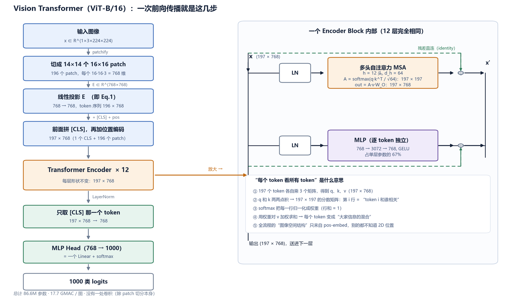
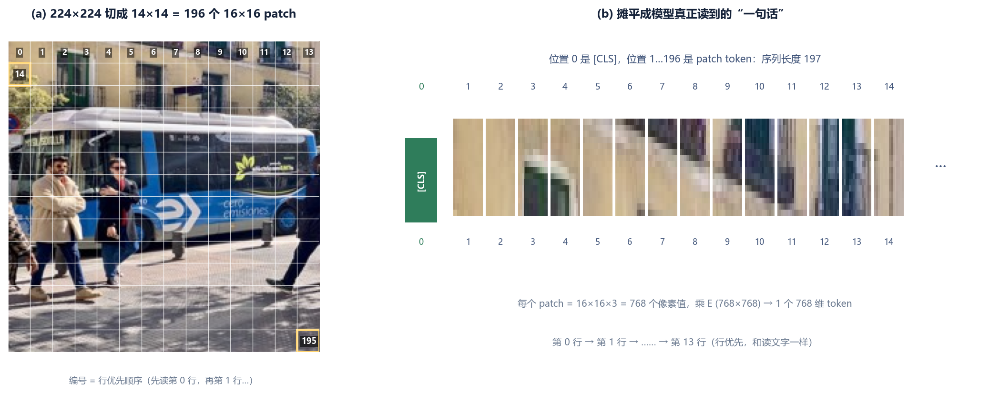

# ViT：从 patch 到分类 logits（PyTorch 手写教学版）

**用途：看清 ViT 架构并验证每一步张量形状。默认不训练、不下载数据、不需要网络。**

此目录基于论文 *An Image is Worth 16x16 Words: Transformers for Image Recognition at Scale*（Dosovitskiy et al., ICLR 2021，arXiv:2010.11929）。代码是可读的教学实现，并非官方仓库逐行复制。

## 先看图





## 建议先打开交互式 Notebook

[`architecture_walkthrough.ipynb`](architecture_walkthrough.ipynb) 是从 patchify 到 Encoder Block 的分步讲解，含可执行单元格、张量 shape 和配图。用 Jupyter Notebook / JupyterLab 打开后，按顺序运行即可；只使用随机张量，不训练模型、不下载数据。

## 不训练，直接跑前向结构跟踪

需要 Python 3.10+ 和 PyTorch；建议 PyTorch 2.x。结构跟踪脚本只需 `torch`，不依赖 `timm`、torchvision、MNIST、GPU 或预训练权重。CPU 可以跑；`arch_trace.py` 创建随机输入，所以**输出是结构检查，不是有意义的图片分类结果**。配图脚本额外需要 `matplotlib` 和 `Pillow`。

在此目录打开 PowerShell / 终端：

```powershell
python arch_trace.py
```

这会构造论文的 ViT-B/16（约 86.6M 参数），用一张随机 `224×224` RGB 图逐层打印形状；只做一次前向，不会反向传播或优化权重。要看更轻的玩具版（28×28 灰度图）：

```powershell
python arch_trace.py --tiny
```

看 384×384 时 token 和计算量如何增长：

```powershell
python arch_trace.py --img 384
```

`--tiny` 用 `P=4, D=96, L=4, h=4`，共 0.46M 参数；论文常用设置 `ViT-B/16` 用 `P=16, D=768, L=12, h=12`，共约 86.6M 参数。结构跟踪在 [arch_trace.py](arch_trace.py)，网络各部件实现在 [vit_model.py](vit_model.py)。

## 前向传播：一张图怎样变成一个类别向量

| 阶段 | ViT-B/16 张量形状 | 直觉 |
|---|---:|---|
| 输入 | `(B, 3, 224, 224)` | RGB 图片 |
| 分成 `16×16` patches | `(B, 196, 768)` | `224/16=14`，所以 `14×14=196` 块；每块有 `16×16×3=768` 个数 |
| Patch embedding | `(B, 196, 768)` | 每块展平后乘同一个可学习矩阵 `E ∈ R^(768×768)`；代码用等价的 `Conv2d(kernel=16, stride=16)` 实现 |
| 加 `[CLS]` 和位置向量 | `(B, 197, 768)` | `[CLS]` 是一个可学习汇总 token；位置编码让模型区分 patch 的空间位置 |
| 重复 12 层 Encoder | `(B, 197, 768)` | token 数和宽度不变；每层含注意力与 MLP 两个残差子层 |
| 最终 LayerNorm，取 `[CLS]` | `(B, 768)` | 用汇总后的向量代表整张图 |
| 分类头 | `(B, 1000)` | 1000 个类别的 logits；训练/推理时可再做 softmax |

`B` 是 batch size；单张图片时 `B=1`。若分类数据集有 10 类，分类头输出就是 `(B, 10)`。

## Encoder Block：真正的 Transformer 部分

代码对应 **pre-LayerNorm** 残差形式：

```text
x = x + MSA(LayerNorm(x))
x = x + MLP(LayerNorm(x))
```

### 多头自注意力 MSA（论文 Eq. 2–3）

1. `qkv = Linear(768 → 3×768)`，然后拆成 `q, k, v`；12 个头，每头 `d_h=768/12=64`。
2. 每个头算 `A = softmax(q @ k.T / sqrt(64))`，其形状是 `(B, 12, 197, 197)`。一个 query 对序列中的每个 key 计算权重。
3. `A @ v` 按权重汇总各 token 的信息，拼接 12 个头后经输出线性层回到 768 维。
4. 加上输入残差。随后经过第二个 LayerNorm、逐 token 的 MLP `768 → 3072 → 768`（中间用 GELU），再加一次残差。

`/sqrt(d_h)` 用来控制点积的尺度，避免 softmax 输入随维度变大而过度饱和。**注意力让 token 相互交换信息；MLP 对每个 token 独立做变换，不负责 token 之间的信息混合。**

### 为什么要位置编码？

Self-attention 本身不会知道 patch 原来在图像左上还是右下。ViT 给序列中每个位置加一个可学习的位置向量。实践：`patch_embed` 输出后打乱 patch 顺序，再观察分类表现（也可在 Notebook 的实验中直接跑）。

### 参数和计算量看什么？

默认 `arch_trace.py` 会显示参数表。以 ViT-B/16 为例，总计约 **86.6M** 参数；Transformer blocks 约占 **98%**，而单个 block 的 MLP 占其参数约 **67%**。在 224 分辨率下约 **17.7 GMAC/image**（按 1 MAC = 2 FLOPs，约 35.4 GFLOPs）。分辨率升高后，patch token 数增加，注意力里的 `N×N` 矩阵带来二次增长；384 分辨率有 576 个 patches（加 CLS 共 577 个 token）。这些 FLOPs 是基于线性层与注意力乘法的理论估算，不同工具对 FLOPs/MACs 的定义会略有不同。

## 推荐阅读顺序

1. 打开 [`architecture_walkthrough.ipynb`](architecture_walkthrough.ipynb)，按单元格顺序运行，逐步观察中间张量。
2. 在 [vit_model.py](vit_model.py) 看 `PatchEmbed → MultiHeadSelfAttention → MLP → TransformerBlock → ViT`。代码刻意写了张量形状和论文公式注释。
3. 跑 `python arch_trace.py --tiny` 看小模型；跑 `python arch_trace.py` 对照 ViT-B/16，重点看 `(B, 12, 197, 197)` 注意力矩阵。
4. 查看 [architecture 图](assets/vit_architecture.png) 与 [patch 图](assets/patchify.png)，从大流程追到单层，再回看代码。
5. 有兴趣时，比较 `P=8` 和 `P=16`：更小的 patch 产生更多 token，注意力矩阵更大，计算开销约随 token 数平方增长。

## 当前实现包含 / 刻意省略

包含：patch 投影、可学习 CLS token、可学习绝对位置编码、pre-LN Transformer Encoder、QKV 多头注意力、GELU MLP、分类头、返回注意力图、位置编码插值、ViT-Ti/B/L/H 的规模构造函数、形状跟踪与参数/计算量估算。

为突出架构而省略：预训练权重、训练/评估流水线、drop-path、相对位置编码、混合 CNN stem、FlashAttention 和大规模预训练。`num_classes=1000` 只代表分类头输出维度，**模型没有加载 ImageNet 权重，随机输入也不会产生真实类别预测**。

位置编码插值有最小实现，但由于 `PatchEmbed` 的卷积仍使用构造时的固定 `img_size` 仅用于元数据（卷积本身可接受不同分辨率），更换输入尺寸时需保证 H/W 可被 patch size 整除，并且先按目标网格插值位置向量。

## 参考

- 论文：[arXiv:2010.11929](https://arxiv.org/abs/2010.11929)
- Google Research 官方实现：[google-research/vision_transformer](https://github.com/google-research/vision_transformer)
- PyTorch 社区实现：[rwightman/pytorch-image-models (timm)](https://github.com/rwightman/pytorch-image-models)
